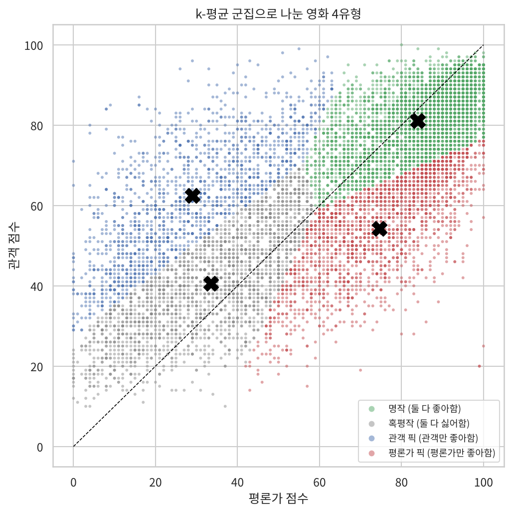
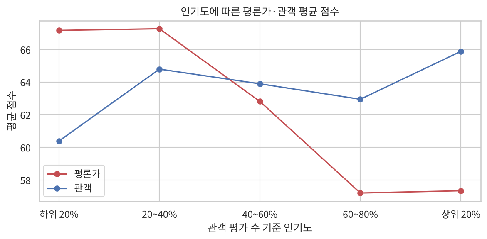

# 평론가와 관객은 왜 다르게 볼까?
로튼토마토 영화 데이터로 평론가 평점과 관객 평점의 차이를 분석한 프로젝트입니다.

## 연구 질문
1. 평론가와 관객의 평가는 얼마나, 어떻게 다른가?
2. 어떤 영화에서 두 평가가 크게 갈리는가? (장르, 제작사, 인기도)
3. 평론가와 관객의 평가 차이는 시대에 따라 어떻게 변해 왔는가?

## 데이터
- 출처: [Kaggle - Rotten Tomatoes movies and critic reviews dataset](https://www.kaggle.com/datasets/stefanoleone992/rotten-tomatoes-movies-and-critic-reviews-dataset)
- 사용 파일: `rotten_tomatoes_movies.csv` (2020년 10월 31일 기준, 영화 17,712편)
- 분석 대상: 평론가 리뷰 20개 이상, 관객 평가 500개 이상, 개봉 연도가 있는 영화 **9,615편**
- 데이터 파일은 용량과 라이선스 문제로 저장소에 포함하지 않았습니다. 위 링크에서 내려받아 노트북과 같은 폴더에 두면 실행됩니다.

## 분석 과정
| 단계 | 내용 |
|---|---|
| 데이터 점검 | `info()`, 결측치, 기술통계 |
| 전처리 | 결측치 처리, 중복치 확인, 파생변수(평가 차이, 장르 원-핫, 제작사 유형), 이상치 확인(IQR, Z-점수) 및 로그 변환 |
| 탐색적 분석 | 점수 분포, 산점도, 상관계수 히트맵, 평가가 크게 갈린 영화 사례 |
| 그룹별 비교 | 장르·제작사·인기도별 평균 평가 차이와 95% 신뢰구간, 박스플롯 |
| 군집 분석 | 평균 수준·평가 차이를 표준화한 k-평균 군집 (엘보우, 실루엣 계수로 k=4 선택) |
| 분류 모델 | 로지스틱 회귀, 의사결정트리, 랜덤포레스트(그리드 서치) 비교, 훈련/테스트 분리와 층화 5겹 교차검증 |
| 시계열 | 개봉 연도별 평균과 5년 이동평균 |

## 주요 결과
- 평론가 점수와 관객 점수의 상관계수는 **0.72**지만, 두 점수가 20점 이상 벌어지는 영화가 **29%**였습니다.
- **장르:** 액션·모험(+5.3), 로맨스, 가족, 코미디는 관객이 더 후했고, 다큐멘터리(−7.2), 고전, 예술·해외영화는 평론가가 더 후했습니다.
- **제작사:** 메이저 스튜디오 영화는 관객이 평균 6.0점 더 후했고, 예술영화 배급사 영화는 평론가가 7.0점 더 후했습니다.
- **인기도:** 관객 평가 수 상위 20% 영화는 평론가 57.3점, 관객 65.9점이었고, 하위 20%는 평론가 67.2점, 관객 60.4점으로 반대였습니다.
- **군집:** 명작(3,963편), 혹평작(2,109편), 평론가 픽(2,045편), 관객 픽(1,498편)의 네 유형으로 나뉘었습니다.
- **분류 모델:** 세 모델 중 튜닝한 랜덤포레스트의 테스트 성능이 가장 높았습니다(F1 0.485, 재현율 0.555, 무작위 기준 0.333). 가장 중요한 변수는 인기도, 개봉 연도, 등급 미분류(NR) 여부였습니다.
- **시대 변화:** 1980년대까지는 평론가가, 1990~2000년대에는 관객이, 2010년대에는 다시 평론가가 더 후했습니다.

<p align="center">
  
  
</p>

## 한계
- 리뷰 수 기준으로 영화를 거르면서, 표본이 어느 정도 알려진 영화 위주로 구성되었습니다.
- 오래된 영화는 현재까지 평가받는 명작 위주로 남아 있을 가능성(생존자 편향)이 있습니다.
- 관객 평가 수는 점수와 같은 시점에 쌓이는 지표이므로, 인기도와 평가 차이의 관계는 인과관계가 아닌 상관관계입니다.
- 제작사 유형은 회사명 키워드로 분류해 일부 오분류가 있을 수 있습니다.
- 분류 모델 성능이 0.56 수준으로, 영화 정보만으로는 평가 차이를 충분히 설명하기 어렵습니다.

## 실행 방법
1. 위 Kaggle 링크에서 `rotten_tomatoes_movies.csv`를 내려받습니다.
2. 노트북(`critic_vs_audience_analysis.ipynb`)과 같은 폴더에 둡니다.
3. 코랩에서 실행할 경우 첫 셀의 한글 폰트 설치 주석을 해제하고 런타임을 다시 시작한 뒤 실행합니다.

## 사용 라이브러리
`pandas`, `numpy`, `matplotlib`, `seaborn`, `scikit-learn`

## 폴더 구조
```
├── README.md
├── critic_vs_audience_analysis.ipynb
└── figures/        # 노트북 실행 시 생성되는 그래프
```
